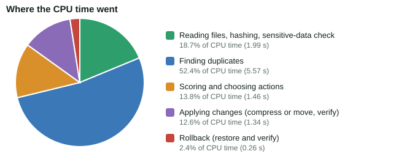

# GreenData AI: results summary

Tested on 3 folder sizes (100 to 2000 files, 0.6 to 12 MB), 3 run(s) each. The folders are generated with known right answers, so every result can be checked.

## The short version (2000 files)

- **Storage saved:** 22% (simple duplicate removal alone: 9%, compressing everything: 29%).
- **Protected files changed:** 0 of 240. Compressing everything changes all 240.
- **Exact copies found:** 100%. **Near-copies found:** 99%.
- **Sensitive files found:** 100%, but only 61% of the files it flagged were really sensitive (order numbers look like phone numbers).
- **Undo (rollback):** restored every file exactly in 9 of 9 runs.
- **Speed:** 15 s to scan 2000 files.
- **CPU:** busy 99% of one core while working (about 99% of this 1-CPU machine). Biggest share: finding duplicates (67%).

## Results by folder size

| Files | Data size | Storage saved | Scan time | CPU time | Undo worked |
|---|---|---|---|---|---|
| 100 | 0.6 MB | 21% | 0.7 s | 0.8 s | 3 of 3 |
| 500 | 3.0 MB | 22% | 3.6 s | 3.9 s | 3 of 3 |
| 2000 | 12.3 MB | 22% | 14.7 s | 16.0 s | 3 of 3 |

## How well it finds things

| What | Found (share of the real ones) | Correct (share of the flagged ones) |
|---|---|---|
| Exact copies | 100% | 100% |
| Near-copies (a few words changed) | 99% | 98% |
| Sensitive files | 100% | 61% |

## Compared with simpler methods (2000 files)

| Method | Storage saved | Protected files changed | Time |
|---|---|---|---|
| GreenData AI | 22% | 0 | 16.2 s |
| Remove exact copies only | 9% | not checked | 0.03 s |
| Compress every file | 29% | 240 (all of them) | 0.30 s |

## CPU usage

CPU utilisation is CPU time divided by elapsed time. The tool runs on one core, so about 100% of one core means it was working the whole time. Measured: 99% of one core, about 99% of the whole machine (1 CPUs). The chart shows where the CPU time went for the largest folder.

- Reading files, hashing, sensitive-data check: 12% (1.9 s)
- Finding duplicates: 67% (10.9 s)
- Scoring and choosing actions: 11% (1.7 s)
- Applying changes (compress or move, verify): 9% (1.4 s)
- Rollback (restore and verify): 2% (0.2 s)

## Read this first

- The data is synthetic (generated by us). Numbers depend on this machine: Python 3.12.3, 1 CPU(s).
- Energy is estimated from CPU time (15 W per busy core).
- The dashboard's energy, CO2 and cost figures are assumptions, not results.
- Full tables with every column: `results_detailed.md`. Raw numbers for every run: `results.csv`.
